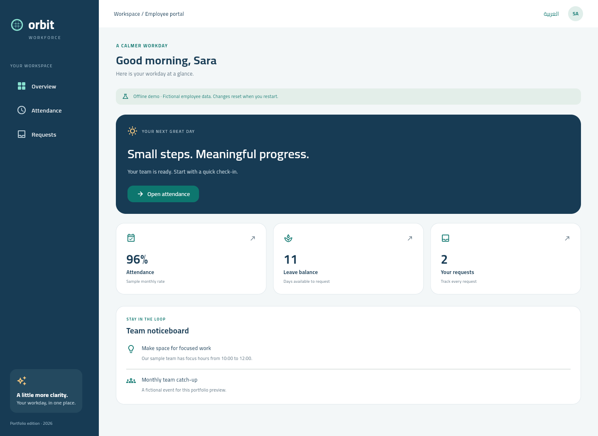
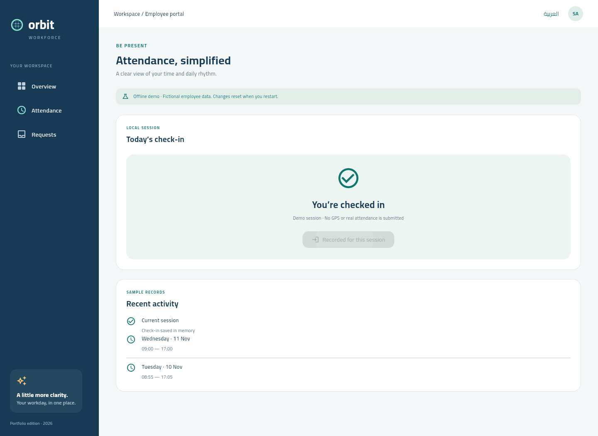
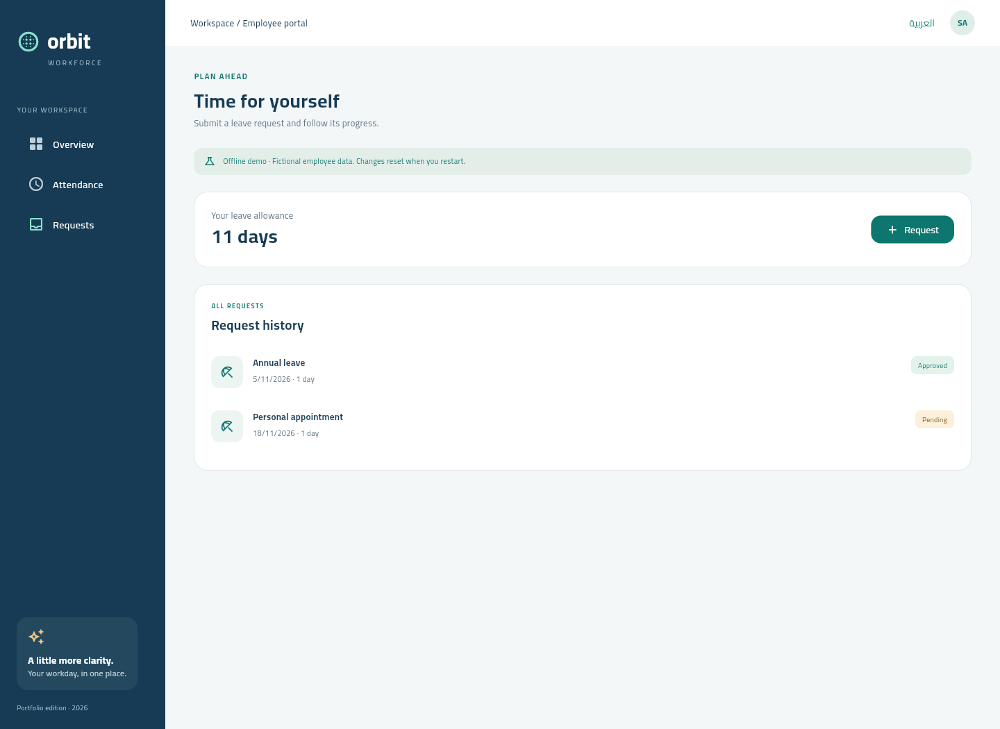
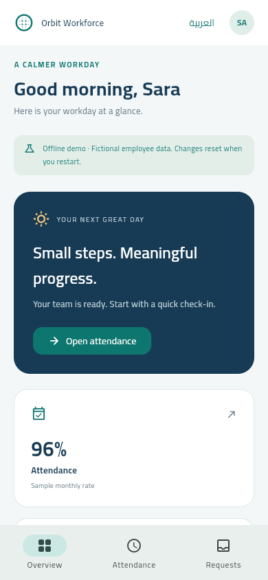
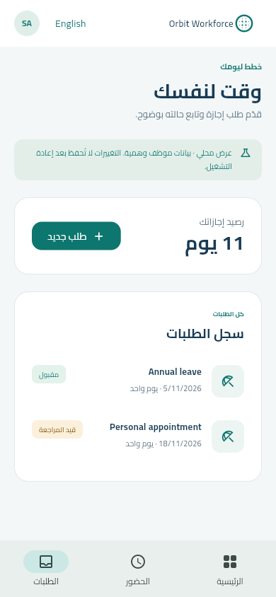

# Orbit Workforce

A Flutter workforce portfolio edition with a new navy-and-teal identity, responsive employee screens and an offline demonstration of attendance and leave requests.

[](https://github.com/Zyadashraf5/orbit-workforce/actions/workflows/ci.yml)



## Experience

- **Overview:** a focused workday summary, leave allowance and sample team notices.
- **Attendance:** session-local check-in with duplicate-tap protection and explicit failure handling.
- **Requests:** create a one-day leave request, validate the reason/date, reject duplicates and update the session allowance.
- **Arabic and English:** RTL/LTR switching across the redesigned navigation and screens. Sample request descriptions remain user-entered text.
- **Responsive Flutter:** desktop sidebar, mobile bottom navigation and layouts checked at 390 px and 1440 px widths.

| Attendance | Requests |
|---|---|
|  |  |

| English mobile | Arabic mobile |
|---|---|
|  |  |

These screenshots were captured from the running Flutter web build. They contain a fictional employee and sample records.

## Provenance and scope

This is a rebranded portfolio edition derived from my existing Flutter HR application. **Orbit is the showcase identity**, not another app claimed to be live on the stores.

The redesigned offline experience lives in `lib/showcase`. The existing ERP-oriented source remains available in `lib/screens`, `lib/model`, `lib/routes` and related directories for review. It is not wired to a live employer system in this repository. This edition uses a new application identifier and clean Git history, without original signing files, embedded Maps values or administrative credentials.

## Run

Use Flutter **3.47.9** (pinned in `.fvmrc`). No Firebase, Odoo, Maps key, login or location permission is needed for the default demo.

```sh
flutter pub get
flutter run -d chrome
```

The default `lib/main.dart` launches `lib/main_demo.dart`. Android can run the same entry point:

```sh
flutter run -d <android-device-id>
flutter build apk --debug --target lib/main_demo.dart
```

All demo changes are in memory and reset on restart. A demo check-in does not verify GPS and never submits real attendance. A leave request never reaches an employer and does not imply approval. The 96% card and historic attendance are labelled sample figures, not measured results.

## Architecture

```text
OrbitWorkspace (responsive widgets, EN/AR)
    -> WorkforceController (state transitions and validation)
        -> WorkforceRepository (explicit contract)
            -> DemoWorkforceRepository (fictional in-memory data)
```

The controller accepts a clock and repository, so failure paths and date rules can be tested without a device or network. Immutable request values and an unmodifiable collection protect the repository boundary.

## Checks

```sh
flutter analyze
flutter test
flutter build web --target lib/main_demo.dart --release --no-web-resources-cdn
```

The complete source passed static analysis after removing inherited deprecated API usage and naming/style issues. **Eight unit/widget tests passed**, covering duplicate check-ins, failed persistence, leave validation, duplicate dates, immutable collections, mobile navigation and Arabic RTL. An additional real-browser check exercised check-in and request submission and observed no external network requests or page errors.

CI checks analysis, tests, web compilation and an Android debug build. iOS has not been built or signed in this Windows workspace.

## ERP integration boundary

`lib/main_erp.dart` retains the previous bootstrap as reference. Administrative tenant discovery/login is intentionally disabled: administrative credentials must never be embedded in a mobile application. The example endpoint addresses cannot connect to a real system.

A production adapter requires a server-side tenant directory, employee authentication, server-enforced permissions and attendance validation, plus private environment-specific configuration. The legacy integration flow is not an operational demo and is not claimed to have been end-to-end tested here. No signing key or production identity should be copied into this repository.

## Identity

Navy `#173B54`, teal `#0D766E`, mint surfaces and warm accent details. The public edition introduces a new wordmark/icon, three redesigned screens and local previews without exposing the original business identity in those screens.
